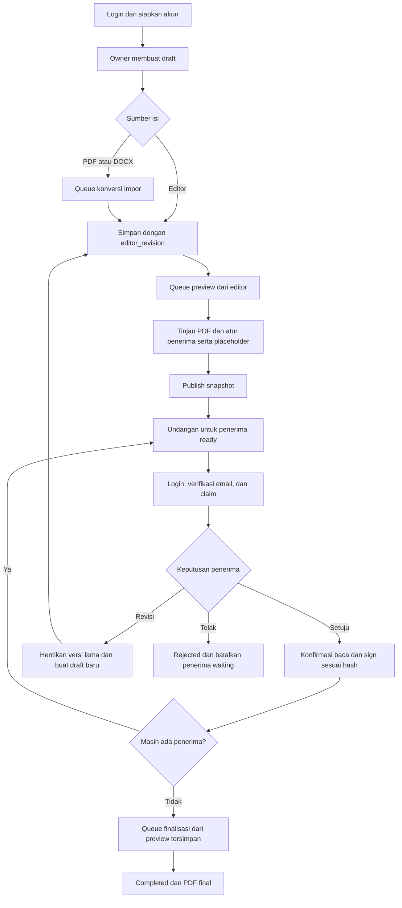
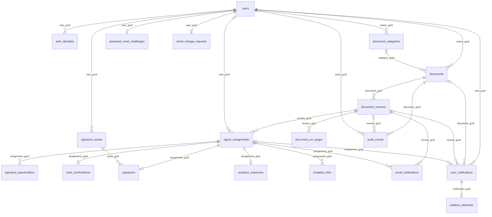

# Dokumen Kita API


Backend Dokumen Kita membantu pemilik dokumen menyusun draft, mengimpor PDF/DOCX, dan meminta persetujuan penerima secara berurutan. Owner meninjau PDF preview dan mengatur posisi tanda tangan; penerima membaca, menandatangani, meminta revisi, atau menolak dokumen. Sistem menyimpan jejak aktivitas dan menghasilkan PDF final setelah seluruh persetujuan selesai.

Antarmuka pengguna berada di repository terpisah, [dokumen-kita-web](../dokumen-kita-web/README.md). Tanda tangan berupa gambar/coretan yang ditempel ke PDF; kode tidak menyediakan sertifikasi tanda tangan digital.

## 1. Fitur utama

| Modul             | Fitur yang tersedia                                                                                                                             |
| ----------------- | ----------------------------------------------------------------------------------------------------------------------------------------------- |
| Akun              | Registrasi, login/logout sesi, verifikasi email, Google OAuth, reset password melalui OTP.                                                      |
| Profil            | Nama, foto privat, perubahan email terverifikasi, perubahan password dan invalidasi sesi lain untuk akun email/password tanpa identitas Google. |
| Dokumen           | Draft, pencarian judul, filter status/kategori, sembunyikan/pulihkan dari daftar owner, impor PDF/DOCX, versi dokumen.                          |
| Editor/PDF        | Blok teks, heading, list, tabel, gambar, delimiter; sanitasi isi, alignment, font, kop/footer, preview asynchronous.                            |
| Persetujuan       | Penerima berurutan, placeholder, undangan dan claim, konfirmasi baca berbasis hash, tanda tangan idempotent, revisi dan penolakan.              |
| Aset tanda tangan | Unggah/coretan gambar, normalisasi PNG, library sendiri, hapus aset yang belum digunakan.                                                       |
| Kategori          | CRUD privat per owner, penetapan kategori tunggal/bulk; kategori terpakai tidak dapat dihapus.                                                  |
| OCR               | OCR.Space untuk halaman scan saat impor dan pencarian viewer; hasil per versi, hash PDF, dan halaman.                                           |
| Aktivitas         | Audit dokumen, histori tanda tangan/permintaan revisi pribadi, status email, inbox dan broadcast privat.                                        |

Konversi PDF/DOCX menghasilkan isi editable dengan layout perkiraan, bukan salinan visual 1:1. Impor PDF mengambil teks native/OCR tanpa merekonstruksi gambar PDF; DOCX dapat mengambil gambar dengan posisi perkiraan. Viewer OCR saat ini **text-only**, tanpa polygon highlight hasil OCR yang terpetakan ke PDF.js. Tinjau `conversion_warnings` dan preview sebelum publish.

## 2. Role dan hak akses

Tidak ada kolom role, tabel permission, middleware role, maupun paket Spatie. Istilah berikut adalah **peran kontekstual** dari policy dan service; satu akun dapat menjadi owner dokumen sendiri sekaligus penerima dokumen lain.

| Peran/kondisi                                | Hak akses                                                                                                               | Pembatasan                                                                                                                   |
| -------------------------------------------- | ----------------------------------------------------------------------------------------------------------------------- | ---------------------------------------------------------------------------------------------------------------------------- |
| Pengunjung                                   | Registrasi, login, recovery, Google OAuth, tautan verifikasi bertanda tangan.                                           | Tidak dapat mengakses route `auth:sanctum`.                                                                                  |
| Akun login                                   | Profil, notifikasi/histori sendiri, kategori/aset sendiri, membuat dokumen.                                             | Tidak otomatis mendapat akses dokumen akun lain.                                                                             |
| Owner dokumen                                | Detail/audit/versi/email; kelola draft, sumber, dekorasi, penerima, placeholder, preview, publish dan retry finalisasi. | Workflow mensyaratkan versi terkini/status sesuai; edit isi hanya pada draft.                                                |
| Penerima terikat (`assignment.user_guid`)    | Detail dokumen, versi yang ditugaskan, audit versi yang ditugaskan, assignment sendiri.                                 | Isi editor dan sumber hanya untuk owner. PDF hanya jika assignment `ready`, `signed`, `revision_requested`, atau `rejected`. |
| Penerima terverifikasi yang mendapat giliran | Claim sesuai email; konfirmasi baca, tanda tangan, revisi atau penolakan.                                               | Versi terkini `in_progress`, assignment `ready`; signing memakai aset sendiri dan hash snapshot yang cocok.                  |
| Akun di luar dokumen                         | Tidak memiliki akses.                                                                                                   | Policy umumnya mengembalikan 404; penerima yang mencoba tindakan owner dapat memperoleh 403.                                 |

Sumber: [policies](app/Policies), [VersionWorkflow](app/Services/VersionWorkflow.php), [InvitationService](app/Services/InvitationService.php), dan [resources](app/Http/Resources). Tidak ada middleware `verified` global; verifikasi email diperiksa service untuk claim dan tindakan penerima.

## 3. Alur penggunaan backend

1. Pengguna registrasi/login melalui sesi Sanctum dan memverifikasi email untuk bertindak sebagai penerima.
2. Owner membuat dokumen dan draft versi pertama, mengisi editor atau mengimpor PDF/DOCX. Impor dijadwalkan untuk dikonversi menjadi blok editor.
3. Client memantau `conversion_status` melalui detail versi. Penyimpanan editor mengirim `editor_revision` terkini; perubahan isi membatalkan hash/preview dan menandai placeholder `needs_review`.
4. Owner meminta preview `source=editor`, menunggu `preview_status=ready`, lalu memeriksa PDF. Renderer menerapkan kop/footer dan font; label Calibri/Aptos memakai font Carlito.
5. Owner mengatur penerima berurutan 1 sampai N tanpa duplikasi dan posisi tanda tangan. Koordinat `x`, `y`, `width`, `height` dinormalisasi 0–1; `page_number` dimulai dari 1.
6. Publish memverifikasi snapshot preview, hash, penerima, dan placeholder. Penerima pertama menjadi `ready`, sisanya `waiting`; undangan dibuat saat giliran aktif.
7. Job email memilih `/login?invitation_token=...` untuk email terdaftar atau `/register?invitation_token=...` untuk email baru. Setelah login/verifikasi, penerima claim memakai token dan email yang sesuai.
8. Penerima mengambil PDF, mengirim konfirmasi baca untuk `version_content_hash`, kemudian sign dengan aset sendiri, `confirmed=true`, dan `idempotency_key`. Request ulang identik mengembalikan signature tersimpan; payload berbeda menghasilkan konflik.
9. Signing mengaktifkan penerima berikutnya. Setelah penerima terakhir selesai, status menjadi `finalizing`; job membentuk PDF final dari **preview tersimpan yang disetujui**, lalu status menjadi `completed`.
10. Permintaan revisi mengubah versi lama menjadi `revision_requested` dan membuat draft berikutnya dengan placeholder yang perlu ditinjau; signature lama tidak disalin. Penolakan mengubah versi/dokumen menjadi `rejected`, membatalkan penerima yang menunggu, dan tidak membuat draft baru melalui alur penolakan.



Status versi: [VersionStatus](app/Enums/VersionStatus.php). Respons `202 Accepted` berarti permintaan diterima, bukan bukti konversi, pengiriman email, atau PDF final sudah selesai.

## 4. Tech stack

| Komponen      | Konfigurasi repository                                                                                                                                                                  |
| ------------- | --------------------------------------------------------------------------------------------------------------------------------------------------------------------------------------- |
| PHP           | Constraint `^8.3` pada `composer.json`.                                                                                                                                                 |
| Laravel       | Constraint `^13.17`; versi lock `13.35.0`.                                                                                                                                              |
| Database      | `.env.example`: MySQL. Config juga menyediakan SQLite, MariaDB, PostgreSQL, SQL Server; bukan bukti seluruh driver diuji. Versi minimum MySQL deployment: **TODO: perlu dikonfirmasi**. |
| Session/cache | Contoh memakai `database`: tabel `sessions`, `cache`, `cache_locks`.                                                                                                                    |
| Queue         | Contoh memakai `database`; queue dokumen `documents`, notifikasi akun umumnya `default`.                                                                                                |
| Storage       | Disk privat `local`: `storage/app/private`; disk `public` dan konfigurasi `s3` tersedia.                                                                                                |
| Realtime      | Driver contoh `log`; transport Pusher tersedia.                                                                                                                                         |
| Email         | Driver contoh `log`; SMTP dapat dikonfigurasi.                                                                                                                                          |
| Aset backend  | Vite `^8.0.0`, Tailwind `^4.0.0`; frontend aplikasi terpisah.                                                                                                                           |
| Web server    | Lokal: `php artisan serve`. Web server production: **TODO: perlu dikonfirmasi**.                                                                                                        |

Predis terpasang, tetapi `.env.example` memilih `REDIS_CLIENT=phpredis`; nilai tersebut memerlukan ekstensi Redis PHP. Redis tidak wajib pada setup database bawaan.

## 5. Package PHP

Constraint berasal dari [composer.json](composer.json), versi lock dari [composer.lock](composer.lock). PHP adalah runtime requirement, bukan package Composer.

| Nama                       | Constraint / versi lock | Fungsi di project                                           |
| -------------------------- | ----------------------- | ----------------------------------------------------------- |
| `laravel/framework`        | `^13.17` / `13.35.0`    | Routing, Eloquent, validasi, session, queue, scheduler.     |
| `laravel/sanctum`          | `^4.0` / `4.3.3`        | Autentikasi SPA melalui cookie sesi.                        |
| `laravel/socialite`        | `^5.31` / `5.31.0`      | Google OAuth dengan provider yang diperluas aplikasi.       |
| `laravel/tinker`           | `^3.0` / `3.0.2`        | REPL Artisan untuk development.                             |
| `dompdf/dompdf`            | `~3.1.6` / `3.1.6`      | Render editor menjadi PDF preview.                          |
| `setasign/fpdf`            | `~1.9.0` / `1.9.0`      | Membentuk halaman PDF dan menempatkan gambar.               |
| `setasign/fpdi`            | `~2.6.9` / `2.6.9`      | Membaca preview untuk dekorasi dan finalisasi.              |
| `smalot/pdfparser`         | `~2.13.1` / `2.13.1`    | Ekstraksi teks PDF/fallback dan pemeriksaan PDF pada tests. |
| `predis/predis`            | `^3.7` / `3.7.0`        | Klien Redis jika `REDIS_CLIENT=predis` dipilih.             |
| `pusher/pusher-php-server` | `^7.3.0` / `7.3.0`      | Transport broadcast Pusher.                                 |

Package `require-dev`:

| Nama                   | Constraint / versi lock | Fungsi di project                                        |
| ---------------------- | ----------------------- | -------------------------------------------------------- |
| `fakerphp/faker`       | `^1.23` / `1.24.1`      | Data factories dan seeder development.                   |
| `laravel/boost`        | `^2.10` / `2.10.3`      | Perangkat bantu konteks Laravel untuk agent development. |
| `laravel/pail`         | `^1.2.5` / `1.2.7`      | CLI pembaca log development.                             |
| `laravel/pao`          | `^1.0.6` / `1.1.5`      | Output alat pengujian untuk agent.                       |
| `laravel/pint`         | `^1.27` / `1.32.1`      | Format kode PHP.                                         |
| `mockery/mockery`      | `^1.6` / `1.6.15`       | Mock dependency pada tests.                              |
| `nunomaduro/collision` | `^8.6` / `8.9.5`        | Tampilan error CLI development/testing.                  |
| `phpunit/phpunit`      | `^12.5.12` / `12.5.39`  | Framework test.                                          |

## 6. Arsitektur dan peta kode

Struktur Laravel memisahkan controller, Form Request, policy, service bisnis, Eloquent, dan API Resource. Tidak ada lapisan repository khusus atau folder listener aplikasi pada checkout ini; event framework seperti `Registered`, `Verified`, dan `PasswordReset` tetap digunakan.

```text
app/
├── Concerns/              HasGuid: UUID publik dan route binding
├── Console/Commands/      Dispatch pekerjaan dan prune challenge OTP
├── Enums/                 Status versi/preview, jenis sumber
├── Events/                DocumentStatusChanged untuk private broadcast
├── Exceptions/            ApiException dan renderer error API
├── Http/
│   ├── Controllers/Api/V1/ Endpoint per modul
│   ├── Middleware/        AssignRequestId
│   ├── Requests/          Validasi dan authorization input
│   └── Resources/         Bentuk respons dan pembatasan field
├── Jobs/                  Konversi, preview, finalisasi, OCR, email, realtime
├── Models/                Eloquent dan relasi
├── Notifications/         Verifikasi, OTP, perubahan email, workflow
├── Policies/              Dokumen, versi, assignment, aset
├── Providers/             Rate limiter, URL verifikasi, provider Google
└── Services/              Aturan bisnis, transaksi/locking, renderer/integrasi
```

Alur umum: `Route → Middleware → Form Request/Policy → Controller → Service → Model → Resource`. Policy juga dipanggil dari controller; tidak semua endpoint memakai Form Request/Resource. Unduhan berupa stream; OAuth/verifikasi berupa redirect.

| Modul route                          | Controller/service utama                                                                    | Lokasi penelusuran                                                                                                                                                                    |
| ------------------------------------ | ------------------------------------------------------------------------------------------- | ------------------------------------------------------------------------------------------------------------------------------------------------------------------------------------- |
| `auth/*`, `me/*`                     | Auth, GoogleAuth, PasswordReset, Me, EmailChange; AuthService, ProfileService               | [controllers](app/Http/Controllers/Api/V1), [requests](app/Http/Requests), [services](app/Services)                                                                                   |
| `documents/*`                        | Document, DocumentImport, DocumentActivity; DocumentService, SourceFileInspector            | [routes/api.php](routes/api.php), [DocumentPolicy](app/Policies/DocumentPolicy.php)                                                                                                   |
| `categories/*`                       | DocumentCategory; DocumentCategoryService                                                   | [service](app/Services/DocumentCategoryService.php)                                                                                                                                   |
| `versions/*`                         | DocumentVersion, VersionPreview/Conversion/Decoration/Publish/Finalization, DocumentPdf/Ocr | [VersionWorkflow](app/Services/VersionWorkflow.php), [DocumentPipelineService](app/Services/DocumentPipelineService.php), [PdfDocumentRenderer](app/Services/PdfDocumentRenderer.php) |
| `assignments/*`, `invitations/claim` | Assignment\*, ReadConfirmation, Invitation                                                  | [SignatureService](app/Services/SignatureService.php), [RevisionService](app/Services/RevisionService.php), [AssignmentRejectionService](app/Services/AssignmentRejectionService.php) |
| `signature-assets/*`                 | SignatureAsset; SignatureAssetService                                                       | [policy](app/Policies/SignatureAssetPolicy.php)                                                                                                                                       |
| `notifications`, `me/history`        | UserNotification, SigningHistory                                                            | [RealtimeNotificationService](app/Services/RealtimeNotificationService.php), [AuditRecorder](app/Services/AuditRecorder.php)                                                          |

Transaksi workflow mengunci document, version, lalu assignment secara konsisten. Revision editor, generation konversi/preview, hash konten, dan `StoredPreviewSnapshot` melindungi snapshot terbaru dari hasil lama.

## 7. Skema database

Sumber: [migrations](database/migrations), [models](app/Models), [factories](database/factories), [seeders](database/seeders). Tabel domain umumnya memiliki `id` numerik dan `guid` unik sebagai identitas publik/foreign key; pengecualian termasuk challenge OTP dan halaman OCR. `public_reference` bukan endpoint berbagi dokumen publik.

| Tabel                       | Data dan relasi utama                                                                                                                                        |
| --------------------------- | ------------------------------------------------------------------------------------------------------------------------------------------------------------ |
| `users`                     | Akun, verifikasi, password nullable, foto; induk kepemilikan/assignment.                                                                                     |
| `auth_identities`           | `user_guid → users.guid`; unik `(provider, provider_user_id)`.                                                                                               |
| `document_categories`       | `owner_guid → users.guid`; nama normalized unik per owner.                                                                                                   |
| `documents`                 | Owner user; kategori nullable dengan FK gabungan `(category_guid, owner_guid)`; `hidden_at` memfilter daftar owner.                                          |
| `document_versions`         | `document_guid → documents.guid`; nomor versi unik per dokumen, isi/dekorasi JSON, revision, state pipeline, lokasi/hash PDF.                                |
| `signer_assignments`        | Version wajib, user nullable; sequence dan email unik per versi.                                                                                             |
| `signature_placeholders`    | Banyak posisi per assignment.                                                                                                                                |
| `read_confirmations`        | Maksimal satu per assignment; hash snapshot dan waktu baca.                                                                                                  |
| `signature_assets`          | Pemilik user, path privat, hash, MIME/dimensi.                                                                                                               |
| `signatures`                | Maksimal satu per assignment; aset, hash snapshot, idempotency key.                                                                                          |
| `recipient_responses`       | Maksimal satu per assignment; revisi/penolakan dan alasan.                                                                                                   |
| `invitation_links`          | Banyak token hash per assignment; expiry/revocation.                                                                                                         |
| `email_notifications`       | Version wajib, assignment opsional; deduplication key, status/retry, payload terenkripsi.                                                                    |
| `user_notifications`        | User wajib; document/version/assignment opsional; deduplikasi per user, payload/read_at.                                                                     |
| `realtime_deliveries`       | Maksimal satu per user notification; retry/delivery state.                                                                                                   |
| `audit_events`              | Document wajib, version/actor opsional; action dan metadata snapshot.                                                                                        |
| `document_ocr_pages`        | Version wajib; unik `(version_guid, pdf_hash, page_number)`; teks/status/error.                                                                              |
| `password_reset_challenges` | Primary key `user_guid`; satu challenge per user, hash OTP/token dan batas percobaan.                                                                        |
| `email_change_requests`     | Satu per user; email baru unik, signature hash dan expiry.                                                                                                   |
| Tabel framework             | `password_reset_tokens`, `personal_access_tokens`, `sessions`, `cache`, `cache_locks`, `jobs`, `job_batches`, `failed_jobs`; `migrations` dikelola migrator. |

ERD domain berikut merangkum relasi; kolom lengkap dan aturan delete mengacu migration. Induk opsional menunjukkan foreign key nullable.



Session memakai `user_id` numerik; personal access token memakai relasi polymorphic Sanctum. Keduanya berbeda dari foreign key GUID domain.

## 8. Dokumentasi API

Base URL lokal: **`http://localhost:8000/api/v1`**. Semua URI tabel modul berikut relatif terhadap `/api/v1`. Parameter model seperti `{document}`, `{version}`, `{assignment}`, `{asset}` memakai GUID melalui `HasGuid`.

Daftar ditelusuri dari [routes/api.php](routes/api.php) dan registrasi route Laravel, termasuk perubahan working tree saat README diperbarui. Periksa setelah perubahan route:

```bash
php artisan route:list --path=api/v1 --no-interaction
php artisan route:list --json --no-interaction
```

Kontrak terpisah: [docs/openapi.yaml](docs/openapi.yaml). Route/kode aktual menjadi rujukan jika spesifikasi belum mencakup endpoint/field terbaru. Tidak ada route Swagger UI atau koleksi Postman pada checkout ini.

### Akun dan autentikasi

| Method | URI                                    | Deskripsi                                      | Auth                 | Role/kondisi                                          |
| ------ | -------------------------------------- | ---------------------------------------------- | -------------------- | ----------------------------------------------------- |
| POST   | `/auth/register`                       | Registrasi, login sesi, queue verifikasi email | Publik               | Pengunjung                                            |
| POST   | `/auth/login`                          | Login email/password                           | Publik               | Pengunjung                                            |
| POST   | `/auth/logout`                         | Hapus sesi aktif                               | Sanctum              | Akun login                                            |
| GET    | `/auth/google/redirect`                | Navigasi ke Google                             | Publik + web session | Pengunjung                                            |
| GET    | `/auth/google/callback`                | Callback dan redirect frontend                 | Publik + OAuth state | Callback provider                                     |
| POST   | `/auth/password/forgot`                | Minta OTP                                      | Publik               | Email akun password; tidak mengungkap keberadaan akun |
| POST   | `/auth/password/verify-otp`            | Tukar OTP menjadi reset token                  | Publik               | OTP valid                                             |
| POST   | `/auth/password/reset`                 | Reset password                                 | Publik               | Reset token valid                                     |
| GET    | `/auth/email/verify/{userGuid}/{hash}` | Verifikasi email, redirect frontend            | Signed URL           | Tautan valid                                          |
| GET    | `/auth/email/change/{requestGuid}`     | Konfirmasi perubahan email                     | Signed URL           | Tautan valid                                          |
| POST   | `/auth/email/resend`                   | Queue ulang verifikasi email                   | Sanctum              | Akun sendiri                                          |

### Profil, histori, notifikasi

| Method | URI                                  | Deskripsi                           | Auth    | Role/kondisi                                             |
| ------ | ------------------------------------ | ----------------------------------- | ------- | -------------------------------------------------------- |
| GET    | `/me`                                | Identitas dan capabilities          | Sanctum | Akun sendiri                                             |
| PATCH  | `/me/profile`                        | Ubah nama                           | Sanctum | Akun sendiri                                             |
| GET    | `/me/photo`                          | Stream foto privat yang diunggah    | Sanctum | Akun sendiri                                             |
| POST   | `/me/photo`                          | Unggah foto                         | Sanctum | Akun sendiri                                             |
| DELETE | `/me/photo`                          | Hapus foto                          | Sanctum | Akun sendiri                                             |
| POST   | `/me/email-change`                   | Queue verifikasi email baru         | Sanctum | Password tersedia, tanpa identitas Google                |
| POST   | `/me/password`                       | Ubah password, invalidasi sesi lain | Sanctum | Password tersedia, tanpa Google; session driver database |
| GET    | `/me/history`                        | Histori signing/permintaan revisi   | Sanctum | Actor sendiri                                            |
| GET    | `/me/history/{event}`                | Detail histori                      | Sanctum | Actor sendiri; action didukung                           |
| GET    | `/notifications`                     | Inbox dan unread count              | Sanctum | Penerima notifikasi sendiri                              |
| PATCH  | `/notifications/{notification}/read` | Tandai dibaca                       | Sanctum | Penerima notifikasi sendiri                              |

### Dokumen dan kategori

| Method | URI                                | Deskripsi                                          | Auth    | Role/kondisi                     |
| ------ | ---------------------------------- | -------------------------------------------------- | ------- | -------------------------------- |
| GET    | `/documents`                       | Daftar dokumen sendiri                             | Sanctum | Owner                            |
| POST   | `/documents`                       | Buat dokumen dan draft                             | Sanctum | Akun login menjadi owner         |
| PATCH  | `/documents/categories`            | Assign/hapus kategori bulk                         | Sanctum | Owner semua dokumen dan kategori |
| GET    | `/documents/{document}`            | Detail dokumen                                     | Sanctum | Owner atau penerima terikat      |
| PATCH  | `/documents/{document}/visibility` | Sembunyikan/pulihkan dari daftar owner             | Sanctum | Owner                            |
| PATCH  | `/documents/{document}/category`   | Assign/hapus kategori                              | Sanctum | Owner dokumen dan kategori       |
| GET    | `/documents/{document}/audit`      | Audit dibatasi versi yang ditugaskan bagi penerima | Sanctum | Owner atau penerima terikat      |
| GET    | `/documents/{document}/versions`   | Versi yang dapat diakses                           | Sanctum | Owner atau penerima terikat      |
| GET    | `/documents/{document}/emails`     | Status email                                       | Sanctum | Owner                            |
| POST   | `/documents/{document}/imports`    | Unggah PDF/DOCX dan antrekan konversi              | Sanctum | Owner; draft terkini             |
| GET    | `/categories`                      | Daftar/pencarian kategori sendiri                  | Sanctum | Owner kategori                   |
| POST   | `/categories`                      | Buat kategori                                      | Sanctum | Akun login                       |
| GET    | `/categories/{category}`           | Detail kategori                                    | Sanctum | Owner kategori                   |
| PUT    | `/categories/{category}`           | Ubah kategori                                      | Sanctum | Owner kategori                   |
| DELETE | `/categories/{category}`           | Hapus kategori kosong                              | Sanctum | Owner; 409 jika terpakai         |
| GET    | `/categories/{category}/documents` | Dokumen sendiri dalam kategori                     | Sanctum | Owner kategori                   |

Visibility hanya memfilter daftar owner; menyembunyikan dokumen tidak mencabut akses penerima atau menghapus data/file.

### Versi, preview, sumber, OCR

| Method | URI                                            | Deskripsi                       | Auth    | Role/kondisi                                         |
| ------ | ---------------------------------------------- | ------------------------------- | ------- | ---------------------------------------------------- |
| GET    | `/versions/{version}`                          | Detail/status versi             | Sanctum | Owner atau penerima versi tersebut                   |
| PATCH  | `/versions/{version}`                          | Simpan judul/isi                | Sanctum | Owner; draft terkini                                 |
| POST   | `/versions/{version}/convert-import`           | Retry konversi                  | Sanctum | Owner; draft terkini, sumber tersedia                |
| POST   | `/versions/{version}/preview`                  | Minta preview `editor`/`upload` | Sanctum | Owner; draft terkini, pembatasan source oleh service |
| GET    | `/versions/{version}/source`                   | File sumber privat              | Sanctum | Owner                                                |
| POST   | `/versions/{version}/finalize`                 | Retry finalisasi                | Sanctum | Owner; versi terkini `finalizing`                    |
| POST   | `/versions/{version}/decorations/{kind}`       | Unggah/ubah kop/footer          | Sanctum | Owner; draft terkini                                 |
| PATCH  | `/versions/{version}/decorations/{kind}`       | Ubah dekorasi/pemilihan halaman | Sanctum | Owner; draft terkini                                 |
| DELETE | `/versions/{version}/decorations/{kind}`       | Hapus dekorasi dengan revision  | Sanctum | Owner; draft terkini                                 |
| GET    | `/versions/{version}/decorations/{kind}/image` | Stream gambar dekorasi          | Sanctum | Owner                                                |
| PUT    | `/versions/{version}/signers`                  | Ganti daftar/urutan penerima    | Sanctum | Owner; draft terkini                                 |
| POST   | `/versions/{version}/publish`                  | Terbitkan snapshot              | Sanctum | Owner; lolos validasi publish                        |
| GET    | `/versions/{version}/pdf`                      | Preview/final jika completed    | Sanctum | Owner atau penerima dengan izin viewPdf              |
| GET    | `/versions/{version}/ocr`                      | Status/pencarian OCR            | Sanctum | Izin viewPdf; expected_hash wajib                    |
| POST   | `/versions/{version}/ocr`                      | Mulai OCR viewer                | Sanctum | Izin viewPdf; expected_hash wajib                    |
| POST   | `/versions/{version}/ocr/retry`                | Retry halaman gagal             | Sanctum | Izin viewPdf; hash dan pages wajib                   |

`{kind}` hanya `letterhead` atau `footer`. Impor editable harus selesai dikonversi dan memakai preview `source=editor`; preview upload PDF merupakan jalur terbatas, bukan cara melewati konversi terbaru.

### Assignment, undangan, aset

| Method | URI                                           | Deskripsi                          | Auth    | Role/kondisi                                       |
| ------ | --------------------------------------------- | ---------------------------------- | ------- | -------------------------------------------------- |
| PUT    | `/assignments/{assignment}/placeholders`      | Ganti posisi tanda tangan          | Sanctum | Owner; draft terkini                               |
| POST   | `/assignments/{assignment}/resend-invitation` | Rotasi/kirim ulang undangan        | Sanctum | Owner; assignment aktif ready                      |
| POST   | `/assignments/{assignment}/read-confirmation` | Konfirmasi baca snapshot           | Sanctum | Penerima terikat, verified, mendapat giliran       |
| POST   | `/assignments/{assignment}/signatures`        | Sign snapshot                      | Sanctum | Penerima terikat, verified, mendapat giliran       |
| POST   | `/assignments/{assignment}/revision-request`  | Minta revisi dan draft berikutnya  | Sanctum | Penerima terikat, verified, mendapat giliran       |
| POST   | `/assignments/{assignment}/reject`            | Tolak dan hentikan versi           | Sanctum | Penerima terikat, verified, mendapat giliran       |
| POST   | `/invitations/claim`                          | Ikat undangan ke akun sesuai email | Sanctum | Email verified; token valid dan giliran aktif      |
| GET    | `/signature-assets`                           | Library aset sendiri               | Sanctum | Pemilik aset                                       |
| POST   | `/signature-assets`                           | Simpan aset drawn/upload           | Sanctum | Akun login                                         |
| GET    | `/signature-assets/{asset}/image`             | Stream PNG privat                  | Sanctum | Pemilik aset                                       |
| DELETE | `/signature-assets/{asset}`                   | Hapus aset dan file                | Sanctum | Pemilik; 409 SIGNATURE_ASSET_IN_USE jika digunakan |

### Endpoint di luar /api/v1

| Method    | URI                    | Deskripsi                                  | Auth                 | Role/kondisi                            |
| --------- | ---------------------- | ------------------------------------------ | -------------------- | --------------------------------------- |
| GET       | `/sanctum/csrf-cookie` | Inisialisasi cookie CSRF                   | Web session          | Browser SPA                             |
| GET, POST | `/broadcasting/auth`   | Otorisasi private channel                  | Sanctum              | GUID channel sama dengan user           |
| GET       | `/up`                  | Health Laravel                             | Publik               | Bukan pemeriksaan worker/provider       |
| GET, PUT  | `/storage/{path}`      | Route file lokal framework saat serve=true | Signed URL framework | Bukan endpoint unduhan dokumen aplikasi |

GET juga menerima HEAD pada registrasi Laravel. [routes/web.php](routes/web.php) hanya menyediakan fallback 404; frontend aplikasi tidak disajikan backend.

### Format respons dan pagination

Resource tunggal umumnya memakai bentuk berikut (nilai placeholder ilustratif):

```json
{
    "data": {
        "guid": "<guid-dokumen>",
        "title": "Contoh dokumen",
        "status": "draft"
    },
    "meta": { "request_id": "<request-id>" }
}
```

Error API melalui `ApiExceptionRenderer`:

```json
{
    "error": {
        "code": "VALIDATION_FAILED",
        "message": "Data yang dikirim tidak valid.",
        "errors": { "title": ["The title field is required."] }
    },
    "meta": { "request_id": "<request-id>" }
}
```

Pesan validasi mengikuti locale; contoh bukan kontrak bahasa tetap. Status umum: `401` sesi tidak ada, `403` tidak berhak/email belum verified, `404` data tidak ditemukan/tidak boleh diungkap, `409` konflik workflow, `419` CSRF, `422` validasi, `429` rate limit. Dengan `APP_DEBUG=false`, exception tak tertangani menjadi `500 INTERNAL_ERROR` tanpa detail internal.

Collection berpagination memakai `data`, `links`, `meta` Laravel (`current_page`, `per_page`, `last_page`, `total`). Tidak semua respons memiliki `meta.request_id`: beberapa JSON manual seperti OCR hanya memakai `data`; middleware API menambahkan `X-Request-Id`. Respons 204 tanpa body, file berupa stream, OAuth/verifikasi berupa redirect.

| Daftar                   | Default / parameter utama                                                                                                                                                  |
| ------------------------ | -------------------------------------------------------------------------------------------------------------------------------------------------------------------------- |
| Dokumen/dokumen kategori | 15 per halaman; per_page 1–100, status, q, visibility=active/hidden, category_guid, uncategorized. Pada daftar umum category_guid dan uncategorized=true saling eksklusif. |
| Audit, versi, email      | 25 per halaman; page, per_page 1–100.                                                                                                                                      |
| Aset tanda tangan        | 15 per halaman; page, per_page 1–100; ID descending.                                                                                                                       |
| Histori pribadi          | 25 per halaman; q, date_from, date_to, page, per_page 1–100; hari filter tanggal Asia/Jakarta.                                                                             |
| Notifikasi               | 20 per halaman; page, per_page 1–100; meta.unread_count.                                                                                                                   |
| Kategori                 | Tanpa per_page: seluruh kategori sendiri. Dengan per_page 1–100: pagination; q, sort_by=created_at/name/documents_count, sort_direction=asc/desc.                          |

## 9. Autentikasi dan otorisasi

1. SPA mengambil `GET /sanctum/csrf-cookie` dengan credentials/cookie aktif.
2. SPA mengirim login dengan email, password, opsional remember, serta header `X-XSRF-TOKEN` dari cookie `XSRF-TOKEN`.
3. Guard `web` meregenerasi sesi dan mengembalikan user. Request selanjutnya mengirim cookie sesi, `Accept: application/json`, dan origin/referer frontend yang terdaftar.
4. Identitas diperiksa melalui `/me`; logout menginvalidasi sesi dan meregenerasi CSRF token.

**Tidak ada endpoint penerbitan bearer token/JWT**, dan `User` tidak memakai trait `HasApiTokens`. Tabel `personal_access_tokens` serta `sanctum.expiration=null` merupakan fondasi Sanctum, bukan bukti login mengembalikan API token. Token undangan, OTP, dan reset token tidak digunakan sebagai Authorization bearer.

| Masa berlaku     | Implementasi                                                                                      |
| ---------------- | ------------------------------------------------------------------------------------------------- |
| Sesi             | SESSION_LIFETIME=120 menit pada contoh; login mendukung remember. Bukan expiry JWT.               |
| Verifikasi email | Signed URL; default kode 60 menit.                                                                |
| Perubahan email  | Signed URL sekali pakai, 60 menit; jeda permintaan 60 detik.                                      |
| OTP reset        | 6 digit, 300 detik, maksimal 5 kesalahan; resend minimal 60 detik.                                |
| Reset token      | 64 karakter, 300 detik, sekali pakai; disimpan sebagai hash. Reset mencabut sesi/token tersimpan. |
| Undangan         | Default 7 hari via INVITATION_EXPIRES_DAYS; dicabut saat rotasi/giliran selesai/revisi/penolakan. |

Policy memisahkan kepemilikan dan penerima, service memeriksa status. Gunakan `capabilities` dari `/me` untuk tindakan profil; akun dengan identitas Google tidak dapat mengganti email/password melalui endpoint profil aplikasi.

## 10. Prasyarat

- PHP sesuai `^8.3`; Composer 2 dengan `composer-runtime-api ^2.2`; MySQL untuk setup contoh.
- Ekstensi framework/dependency: Ctype, Filter, Hash, Mbstring, OpenSSL, Session, Tokenizer, DOM/Libxml, JSON; PDO dan pdo_mysql untuk MySQL.
- Fitur dokumen: ZIP/ZipArchive, DOM/XML, Fileinfo, GD dengan dukungan format gambar yang digunakan. Testing memerlukan XML/XMLWriter dan pdo_sqlite untuk konfigurasi bawaan PHPUnit.
- Binary `pdftotext` di PATH dianjurkan untuk PDF digital; `PDFTOTEXT_BINARY` dapat memakai path executable absolut. Fallback parser PHP tersedia.
- Konektivitas dan credential provider untuk fitur OCR/Google/Pusher/SMTP yang dipilih.
- Node/npm hanya untuk aset backend/frontend. Backend package.json tidak menentukan engines dan checkout ini tidak memiliki lockfile npm: **TODO: perlu dikonfirmasi** versi Node/npm standar backend. Frontend yang diperiksa mensyaratkan Node `^22.18.0 || >=24.12.0`.

```bash
php -v
php -m
composer check-platform-reqs
```

Periksa PHP CLI dan PHP-FPM/web server karena keduanya dapat memakai php.ini berbeda.

## 11. Instalasi dan menjalankan lokal

URL clone resmi: **TODO: perlu dikonfirmasi**. Ganti placeholder sebelum menjalankan:

```bash
git clone <URL_REPOSITORY_BACKEND> dokumen-kita-api
cd dokumen-kita-api
composer install
```

Salin konfigurasi satu kali. PowerShell:

```powershell
Copy-Item .env.example .env
```

Alternatif POSIX:

```bash
cp .env.example .env
```

Buat database `dokumen_kita_api` dan sesuaikan koneksi `.env`. Contoh non-secret:

```env
APP_URL=http://localhost:8000
FRONTEND_URL=http://localhost:5173
CORS_ALLOWED_ORIGINS=http://localhost:5173
SANCTUM_STATEFUL_DOMAINS=localhost:5173,localhost:8000
DB_CONNECTION=mysql
DB_HOST=127.0.0.1
DB_PORT=3306
DB_DATABASE=dokumen_kita_api
SESSION_DRIVER=database
CACHE_STORE=database
QUEUE_CONNECTION=database
DOCUMENT_QUEUE_CONNECTION=database
DOCUMENT_QUEUE=documents
DB_QUEUE_RETRY_AFTER=240
```

Isi username/password database lokal tanpa commit credential. Kemudian:

```bash
php artisan key:generate --no-interaction
php artisan migrate --no-interaction
```

Opsional untuk database development baru:

```bash
php artisan db:seed --no-interaction
php artisan storage:link --no-interaction
```

Seeder membuat akun contoh, bukan data production. `storage:link` hanya menghubungkan `storage/app/public` ke `public/storage`; dokumen tetap privat dan tidak membutuhkan symlink publik.

Jalankan tiga terminal terpisah:

```bash
# Terminal 1: API
php artisan serve --host=localhost --port=8000
```

```bash
# Terminal 2: worker pada setup default
php artisan queue:work database --queue=documents,default --sleep=1 --tries=3 --timeout=180
```

```bash
# Terminal 3: scheduler
php artisan schedule:work
```

Periksa `http://localhost:8000/up`. Untuk aset backend: `npm install --ignore-scripts` lalu `npm run build`; API tidak memerlukan Vite development server. `composer run setup` memasang dependency, membuat key, migrasi, dan build aset; tidak menjalankan seeder, scheduler, atau setup provider lengkap.

## 12. Environment variables

Tabel mencakup assignment aktif dan contoh dikomentari pada [.env.example](.env.example). Credential selalu placeholder; simpan secret hanya pada environment lokal/server.

| Variabel                                                | Deskripsi                              | Contoh nilai                             |
| ------------------------------------------------------- | -------------------------------------- | ---------------------------------------- |
| `APP_NAME`                                              | Nama aplikasi/email/cookie default     | `Laravel` (bawaan contoh)                |
| `APP_ENV`                                               | Environment                            | `local`                                  |
| `APP_KEY`                                               | Kunci enkripsi dari key:generate       | `<dibuat-lokal>`                         |
| `APP_DEBUG`                                             | Detail debug                           | `true` untuk lokal                       |
| `APP_URL`                                               | Origin backend dan signed link         | `http://localhost:8000`                  |
| `FRONTEND_URL`                                          | Origin redirect/undangan               | `http://localhost:5173`                  |
| `CORS_ALLOWED_ORIGINS`                                  | Origin diizinkan, dipisah koma         | `http://localhost:5173`                  |
| `SANCTUM_STATEFUL_DOMAINS`                              | Host:port SPA/backend tanpa scheme     | `localhost:5173,localhost:8000`          |
| `APP_LOCALE`, `APP_FALLBACK_LOCALE`, `APP_FAKER_LOCALE` | Bahasa/fallback/data dummy             | `en`, `en`, `en_US`                      |
| `APP_MAINTENANCE_DRIVER`                                | Status maintenance                     | `file`                                   |
| `APP_MAINTENANCE_STORE`                                 | Contoh store maintenance, dikomentari  | `database`                               |
| `PHP_CLI_SERVER_WORKERS`                                | Contoh worker server PHP, dikomentari  | `4`; dukungan tergantung platform        |
| `BCRYPT_ROUNDS`                                         | Biaya hash password                    | `12`                                     |
| `LOG_CHANNEL`, `LOG_STACK`                              | Kanal dan anggota stack                | `stack`, `single`                        |
| `LOG_DEPRECATIONS_CHANNEL`, `LOG_LEVEL`                 | Deprecation dan tingkat log            | `null`, `debug`                          |
| `DB_CONNECTION`, `DB_HOST`, `DB_PORT`                   | Driver/server database                 | `mysql`, `127.0.0.1`, `3306`             |
| `DB_DATABASE`                                           | Nama database                          | `dokumen_kita_api`                       |
| `DB_USERNAME`, `DB_PASSWORD`                            | Credential database                    | `<db-user>`, `<secret-lokal>`            |
| `SESSION_DRIVER`, `SESSION_LIFETIME`                    | Store sesi dan lifetime menit          | `database`, `120`                        |
| `SESSION_ENCRYPT`, `SESSION_PATH`, `SESSION_DOMAIN`     | Enkripsi payload dan cakupan cookie    | `false`, `/`, `null`                     |
| `BROADCAST_CONNECTION`                                  | Driver broadcast                       | `log` atau `pusher`                      |
| `PUSHER_APP_ID`, `PUSHER_APP_KEY`, `PUSHER_APP_SECRET`  | Credential Pusher                      | `<id>`, `<key>`, `<secret-server>`       |
| `PUSHER_APP_CLUSTER`                                    | Cluster                                | `ap1`                                    |
| `FILESYSTEM_DISK`                                       | Disk default Laravel                   | `local`                                  |
| `DOCUMENT_DISK`                                         | Disk privat dokumen/profil             | `local`                                  |
| `DOCUMENT_QUEUE_CONNECTION`, `DOCUMENT_QUEUE`           | Koneksi/nama queue dokumen             | `database`, `documents`                  |
| `DB_QUEUE_RETRY_AFTER`                                  | Detik sebelum retry job database       | `240`                                    |
| `QUEUE_CONNECTION`                                      | Koneksi queue default                  | `database`                               |
| `DOCUMENT_OCR_ENABLED`                                  | Aktifkan OCR                           | `false`                                  |
| `OCR_SPACE_API_KEY`                                     | Key backend OCR.Space                  | `<secret-server>`                        |
| `DOCUMENT_OCR_MAX_PAGES`, `DOCUMENT_OCR_MAX_BYTES`      | Batas PDF OCR                          | `3`, `1000000`                           |
| `DOCUMENT_OCR_TIMEOUT`                                  | Timeout OCR, detik                     | `60`                                     |
| `INVITATION_EXPIRES_DAYS`                               | Expiry undangan, hari                  | `7`                                      |
| `CACHE_STORE`                                           | Cache dan unique-job locks             | `database`                               |
| `CACHE_PREFIX`                                          | Prefix cache; contoh dikomentari       | `dokumen-kita-cache-`                    |
| `MEMCACHED_HOST`                                        | Server jika memilih Memcached          | `127.0.0.1`                              |
| `REDIS_CLIENT`, `REDIS_HOST`, `REDIS_PORT`              | Klien/server Redis opsional            | `phpredis`, `127.0.0.1`, `6379`          |
| `REDIS_PASSWORD`                                        | Credential Redis opsional              | `null` pada contoh tanpa auth            |
| `MAIL_MAILER`, `MAIL_SCHEME`                            | Transport dan scheme                   | `log`, `null`                            |
| `MAIL_HOST`, `MAIL_PORT`                                | Server SMTP                            | `127.0.0.1`, `2525`                      |
| `MAIL_USERNAME`, `MAIL_PASSWORD`                        | Credential SMTP                        | `<smtp-user>`, `<secret-server>`         |
| `MAIL_FROM_ADDRESS`, `MAIL_FROM_NAME`                   | Pengirim                               | `hello@example.com`, `"${APP_NAME}"`     |
| `AWS_ACCESS_KEY_ID`, `AWS_SECRET_ACCESS_KEY`            | Credential disk S3/layanan AWS pilihan | `<key>`, `<secret-server>`               |
| `AWS_DEFAULT_REGION`, `AWS_BUCKET`                      | Region/bucket                          | `us-east-1`, `<bucket-privat>`           |
| `AWS_USE_PATH_STYLE_ENDPOINT`                           | Mode endpoint S3                       | `false`                                  |
| `VITE_APP_NAME`                                         | Nama untuk aset backend                | `"${APP_NAME}"`                          |
| `GOOGLE_CLIENT_ID`, `GOOGLE_CLIENT_SECRET`              | Credential OAuth server                | `<client-id>`, `<secret-server>`         |
| `GOOGLE_REDIRECT_URI`                                   | Callback terdaftar di Google           | `${APP_URL}/api/v1/auth/google/callback` |

Variabel tambahan yang dibaca config tetapi belum dicantumkan pada .env.example:

| Variabel                                                             | Deskripsi                                | Contoh nilai                  |
| -------------------------------------------------------------------- | ---------------------------------------- | ----------------------------- |
| `PDFTOTEXT_BINARY`                                                   | Executable ekstraksi                     | `pdftotext` atau path absolut |
| `DOCUMENT_BINARY_TIMEOUT`                                            | Timeout binary, detik                    | `60`                          |
| `DOCUMENT_IMPORT_MAX_KB`                                             | Batas upload sumber                      | `20480`                       |
| `MAIL_TIMEOUT`                                                       | Timeout SMTP, detik                      | `10`                          |
| `GOOGLE_CONNECT_TIMEOUT`, `GOOGLE_HTTP_TIMEOUT`, `GOOGLE_IP_RESOLVE` | Koneksi/request OAuth dan IP             | `5`, `10`, `v4`               |
| `SESSION_SECURE_COOKIE`, `SESSION_SAME_SITE`                         | Pengamanan cookie hosting                | `true`, `lax` sesuai topologi |
| `AWS_ENDPOINT`, `AWS_URL`                                            | Endpoint/URL disk S3-compatible opsional | `<endpoint-storage>`          |

OCR memakai endpoint yang ditentukan `OcrSpaceOcrClient`; batas di-clamp maksimal 3 halaman, 1.000.000 byte, timeout 60 detik. PDF digital tanpa halaman scan tidak dikirim untuk OCR; PDF scan yang diproses OCR dikirim server-to-server ke provider eksternal.

## 13. Akun default development

[DatabaseSeeder](database/seeders/DatabaseSeeder.php) membuat satu akun melalui [UserFactory](database/factories/UserFactory.php):

| Nama      | Email development  | Password development               | Role/status                             |
| --------- | ------------------ | ---------------------------------- | --------------------------------------- |
| Test User | `test@example.com` | `password` (literal dummy factory) | Akun biasa, email verified; bukan admin |

**Jangan gunakan akun/kredensial dummy ini di production.** Tidak ada seeder role/admin. Seeder memakai create; menjalankannya lagi dengan email yang sudah ada dapat menghasilkan duplicate key. Kredensial di atas berasal dari source fixture publik, bukan environment nyata.

## 14. Queue, scheduler, background jobs

Jadwal: [routes/console.php](routes/console.php).

| Jadwal                             | Perintah                       | Peran                                                                                 |
| ---------------------------------- | ------------------------------ | ------------------------------------------------------------------------------------- |
| Setiap 5 detik, withoutOverlapping | documents:process              | Dispatch pending conversion, preview, finalisasi, email, realtime, OCR dari database. |
| Harian                             | auth:prune-password-challenges | Hapus challenge OTP/reset token kedaluwarsa.                                          |

| Job/notifikasi                       | Pekerjaan                                | Koneksi/queue                                                                              |
| ------------------------------------ | ---------------------------------------- | ------------------------------------------------------------------------------------------ |
| ConvertDocumentImport                | Sumber menjadi editor data               | documents.processing.connection/queue                                                      |
| GenerateDocumentPreview              | Render/simpan preview dan hash           | Config dokumen; dispatch langsung preview juga menetapkan queue documents secara eksplisit |
| FinalizeDocument                     | Tempel signature ke snapshot preview     | Config dokumen                                                                             |
| ProcessDocumentOcr                   | OCR per PDF hash                         | Config dokumen                                                                             |
| DeliverDocumentEmail                 | Email workflow dan state/retry service   | Config dokumen                                                                             |
| DeliverRealtimeNotification          | Broadcast privat dan state/retry service | Config dokumen                                                                             |
| VerifyEmail, EmailChangeVerification | Queued notification akun                 | Koneksi/queue default                                                                      |
| PasswordResetOtp                     | OTP terenkripsi di antrean               | **Koneksi database ditetapkan kode**, queue default                                        |

Pada contoh, worker `database --queue=documents,default` menangani keduanya. Jika driver/queue diubah, sediakan worker untuk koneksi dokumen, default akun, serta database/default untuk OTP. Mengubah DOCUMENT_QUEUE juga perlu mempertimbangkan dispatch preview yang eksplisit ke documents.

Timeout worker harus lebih kecil dari retry interval koneksi: contoh `180 < 240` detik. Timeout job conversion 180 detik, preview/finalisasi 60 detik, OCR 120 detik. Retry email/realtime juga diatur state service; opsi tries worker bukan satu-satunya pengatur retry.

Cron production memanggil scheduler setiap menit; task submenit tetap dikelola scheduler Laravel:

```cron
* * * * * cd /srv/dokumen-kita-api && php artisan schedule:run >> /dev/null 2>&1
```

Path merupakan contoh. `php artisan serve` tidak menjalankan worker/scheduler. `composer run dev` menjalankan server, queue listener default, Vite; tidak menggantikan worker queue dokumen dan scheduler.

## 15. Perintah Artisan kustom

| Perintah                                     | Fungsi                                                                                |
| -------------------------------------------- | ------------------------------------------------------------------------------------- |
| `php artisan documents:process`              | Dispatch pekerjaan durable pending; worker tetap diperlukan untuk queue asynchronous. |
| `php artisan auth:prune-password-challenges` | Hapus challenge yang OTP dan reset token-nya kedaluwarsa.                             |
| `php artisan inspire`                        | Command contoh Laravel; tidak terkait workflow dokumen.                               |

Perintah operasional framework:

```bash
php artisan schedule:list
php artisan queue:failed
php artisan queue:restart
php artisan config:clear
```

Queue restart memberi sinyal worker memuat kode baru setelah job berjalan selesai; process manager harus menghidupkannya kembali.

## 16. Testing dan kualitas kode

Framework: **PHPUnit 12**, Laravel TestCase, RefreshDatabase, factories, mock/fake storage dan provider. Tidak ada suite Pest atau konfigurasi PHPStan pada checkout ini. `phpunit.xml` memakai SQLite in-memory, session/cache array, mailer array, queue sync, broadcast null untuk setup test bawaan.

```bash
# Seluruh test suite
composer test

# Test terarah sesuai perilaku yang berubah
php artisan test --compact --filter=SignatureAssetApiTest
php artisan test --compact --filter=PdfRendererWorkflowTest

# Periksa format tanpa menulis ulang
vendor/bin/pint --test

# Format PHP yang berubah sesuai panduan repository
vendor/bin/pint --dirty --format agent
```

Tests mencakup auth, authorization, file privat, revision conflict, signing order/idempotency, pipeline PDF, kategori/profil, OCR/notifikasi. Persyaratan concurrency:

- SignatureConcurrencyTest dan AssignmentRejectionConcurrencyTest: opt-in `RUN_MYSQL_CONCURRENCY_TESTS=1`; membuat/menghapus database MySQL terisolasi acak dan membutuhkan hak sesuai.
- MySqlPasswordResetConcurrencyTest hanya berjalan pada MySQL database `dokumen_kita_otp_test` dan menjalankan **migrate:fresh** di database tersebut. Gunakan database khusus pengujian.

Test otomatis tidak membuktikan browser, queue nyata, inbox SMTP, Google OAuth, subscription Pusher, atau layout PDF production. Pembaruan README ini memeriksa source/route dan konsistensi dokumentasi; bukan laporan kelulusan test suite.

## 17. Deployment

Repository belum menyediakan konfigurasi Nginx/Supervisor/container atau domain production. Bagian ini checklist dan contoh yang harus disesuaikan, bukan deskripsi hosting yang sudah berjalan. **TODO: perlu dikonfirmasi** domain backend/frontend, web server, socket PHP-FPM, process manager, database, disk dan provider production.

- [ ] APP_ENV=production, APP_DEBUG=false, APP_URL, frontend origin, CORS, domain Sanctum, cookie HTTPS dan secret environment diatur.
- [ ] APP_KEY dipertahankan antar-release dan dibackup aman; payload email terenkripsi bergantung pada key tersebut.
- [ ] Jalankan `composer install --no-dev --optimize-autoloader` dan `composer check-platform-reqs --no-dev` pada target.
- [ ] Backup database/file; `php artisan migrate --force --no-interaction`. Hindari seeder development.
- [ ] Document root hanya public/; jangan mengekspos .env, repository, atau storage/app/private.
- [ ] User PHP/worker dapat menulis storage/, bootstrap/cache/, temp dan cache font Dompdf yang dikonfigurasi; hindari permission global 777.
- [ ] Sertakan resources/fonts/Carlito-\*.ttf dan lisensinya; pastikan cache font writable.
- [ ] Jalankan `php artisan optimize` atau cache granular `php artisan config:cache` dan `php artisan route:cache`; periksa exit status pada target.
- [ ] Supervisor/systemd/process manager menjaga worker tetap berjalan dan restart otomatis. Contoh command: `php artisan queue:work database --queue=documents,default --sleep=1 --tries=3 --timeout=180`.
- [ ] Aktifkan cron; setelah deploy jalankan `php artisan queue:restart` dan `php artisan schedule:interrupt` agar proses lama memuat release baru.
- [ ] Sesuaikan upload_max_filesize, post_max_size, web server limit dengan batas aplikasi 20.480 KB; POST limit menampung overhead multipart.
- [ ] Konfirmasi adapter sebelum memilih s3: config tersedia, tetapi adapter S3 tidak tercantum pada direct requirements. Jangan menganggap S3/R2 siap dari variabel saja.
- [ ] Uji staging: login, akses dua akun, konversi, preview, publish, signing, PDF final, failed jobs dan provider nyata.

Contoh server Nginx untuk PHP-FPM; domain/path/socket adalah placeholder. Pasang pada konfigurasi HTTPS deployment yang disiapkan:

```nginx
server {
    listen 443 ssl;
    server_name api.example.test;
    root /srv/dokumen-kita-api/public;
    index index.php;
    ssl_certificate /path/to/fullchain.pem;
    ssl_certificate_key /path/to/privkey.pem;
    client_max_body_size 24m;

    location / {
        try_files $uri $uri/ /index.php?$query_string;
    }

    location = /index.php {
        include fastcgi_params;
        fastcgi_param SCRIPT_FILENAME $realpath_root$fastcgi_script_name;
        fastcgi_param DOCUMENT_ROOT $realpath_root;
        fastcgi_pass unix:/run/php/your-php-fpm.sock;
    }

    location ~ \.php$ {
        return 404;
    }

    location ~ /\.(?!well-known).* {
        deny all;
    }
}
```

Contoh belum diuji pada hosting tertentu. Sesuaikan TLS, redirect HTTP, proxy, limit upload, timeout dan socket dengan infrastruktur yang dikonfirmasi; validasi sebelum reload server.

## 18. Keamanan

| Area             | Implementasi/batas                                                                                                                        |
| ---------------- | ----------------------------------------------------------------------------------------------------------------------------------------- |
| Login/registrasi | Login 5/menit per email+IP; registrasi/Google 10/menit per IP.                                                                            |
| Recovery         | Forgot 10/menit per IP, 1/menit dan 5/jam per email; verify/reset 10/menit per IP; OTP maksimal 5 kesalahan.                              |
| Upload/undangan  | Upload 20/menit per user; claim 10/menit per user+IP; resend 3/menit per user+assignment.                                                 |
| Workflow         | Preview/konversi/finalisasi/OCR/revisi/penolakan 10/menit; publish 20/menit; read/sign 30/menit.                                          |
| Email            | Verifikasi/resend/perubahan email: limiter route 6/menit; perubahan email juga dibatasi service.                                          |
| Authorization    | auth:sanctum, Form Request, policy, query scoped owner/user, workflow guard service.                                                      |
| CORS/CSRF        | Origin eksplisit dari env, credentials aktif; CSRF untuk request SPA yang mengubah data.                                                  |
| Sumber           | Maksimal 20.480 KB default; cek bytes PDF/struktur DOCX dan ekstensi; PDF terenkripsi ditolak. DOCX diperiksa batas entry dan ukuran ZIP. |
| Gambar           | JPG/PNG/WebP dibatasi ukuran/dimensi; signature dinormalisasi PNG, dicek tinta/hash, disimpan privat.                                     |
| Editor/PDF       | Sanitasi blok/inline markup, remote image tak didukung ditolak; remote resource, PHP dan JavaScript Dompdf dinonaktifkan.                 |
| Integritas       | Hash snapshot/manifest, locking, revision/generation guard, konfirmasi baca, idempotency key.                                             |
| Token            | Undangan/reset disimpan sebagai hash; payload email sensitif terenkripsi; OTP notification queue terenkripsi.                             |

Batas teknis di [config/documents.php](config/documents.php): 200 halaman, 50 penerima, 100 placeholder per penerima, 500 blok editor. Komentar config masih menyebut sebagian batas sebagai placeholder keputusan produk: **TODO: perlu dikonfirmasi** batas resmi production. Tidak ada pipeline antivirus upload yang terlihat pada kode.

## 19. Integrasi frontend

Lihat [README frontend](../dokumen-kita-web/README.md). Konfigurasi untuk backend nyata:

```env
VITE_AUTH_MODE=api
VITE_API_BASE_URL=http://localhost:8000
```

Default contoh frontend adalah prototype; ubah menjadi api. Base URL adalah origin backend **tanpa /api/v1** karena adapter menambahkan prefix. Aktifkan cookie/credentials, ambil CSRF sebelum login, dan konsisten memakai host; jangan mencampur localhost/127.0.0.1 tanpa menyesuaikan cookie.

```powershell
Set-Location ..\dokumen-kita-web
Copy-Item .env.example .env.local
npm ci
npm run dev
```

Client realtime berlangganan private channel `users.{userGuid}` (prefix transport Pusher: private-). `/broadcasting/auth` mencocokkan GUID channel dengan akun login; event `document.status.changed`. Driver log hanya mencatat event, tidak mengirim ke browser.

## 20. Troubleshooting

| Gejala                                             | Pemeriksaan/solusi                                                                                                      |
| -------------------------------------------------- | ----------------------------------------------------------------------------------------------------------------------- |
| Permission denied / gagal simpan PDF               | User worker/PHP, storage, bootstrap/cache, temp, disk privat dan cache font harus writable.                             |
| Database/table tidak ada                           | Cocokkan DB\_\*, migrate, config:clear setelah perubahan env; session/cache/queue database juga memerlukan tabel.       |
| CORS error                                         | Cocokkan origin persis, host:port Sanctum, credentials client; jangan wildcard origin untuk cookie.                     |
| 401 UNAUTHENTICATED                                | Cek cookie terkirim, origin/referer stateful, domain/host, expiry sesi; login ulang.                                    |
| 419 CSRF                                           | Ambil ulang sanctum/csrf-cookie dan kirim X-XSRF-TOKEN dengan credentials.                                              |
| EMAIL_NOT_VERIFIED                                 | Verifikasi email sebelum claim/tindakan penerima; jalankan worker akun.                                                 |
| Undangan invalid/expired                           | Gunakan email tujuan verified; owner resend pada assignment ready. Link lama dapat dicabut saat rotasi/giliran selesai. |
| Pipeline terus pending                             | Cek scheduler, koneksi/queue worker, documents:process, log, queue:failed; 202 bukan selesai.                           |
| OTP tidak terkirim dengan worker Redis             | OTP eksplisit memakai database/default; jalankan worker koneksi itu juga.                                               |
| Email tidak masuk                                  | MAIL_MAILER=log hanya menulis log. Periksa SMTP, jaringan, worker dan inbox/provider; sent bukan bukti diterima inbox.  |
| EDITOR_REVISION_CONFLICT                           | Muat state terbaru, rekonsiliasi perubahan, kirim revision terkini.                                                     |
| PREVIEW_NOT_READY / PLACEHOLDERS_NEED_REVIEW       | Buat/tunggu preview terbaru, tinjau PDF, simpan ulang placeholder sebelum publish.                                      |
| READ_CONFIRMATION_REQUIRED / CONTENT_HASH_MISMATCH | Ambil PDF/hash terbaru, konfirmasi baca, sign dengan hash sama dan idempotency key sesuai.                              |
| OCR tidak tersedia/terbatas                        | Cek flag/key backend, batas 3 halaman/1.000.000 byte, quota, error halaman; belum ada polygon highlight.                |
| Ekstraksi/layout impor kurang baik                 | Periksa pdftotext/path absolut dan warnings, kebutuhan OCR; hasil impor perlu ditinjau manual.                          |
| Font/preview berbeda                               | Sertakan Carlito dan pastikan cache font writable; preview backend menjadi snapshot signing.                            |
| Worker memakai kode lama                           | queue:restart dan pastikan process manager menghidupkan ulang worker.                                                   |
| Redis client tidak ditemukan                       | Pilih predis terpasang atau sediakan ekstensi phpredis sesuai config.                                                   |
| Perubahan password 503                             | Implementasi invalidasi sesi lain membutuhkan SESSION_DRIVER=database.                                                  |
| Route / memberi 404                                | Sesuai fallback backend; gunakan frontend terpisah atau /up untuk health.                                               |

## 21. Kontribusi dan lisensi

Baca [AGENTS.md](AGENTS.md). Pertahankan kontrak /api/v1, file privat, invariants versi/signing, dan perubahan terfokus. Tambahkan/perbarui tes perilaku, jalankan tes terarah dan Pint, lalu perbarui kontrak API terkait. Jangan commit .env, credential provider, token atau dokumen pengguna.

Composer menyatakan lisensi **MIT**, tetapi file lisensi root belum ada pada checkout ini. **TODO: perlu dikonfirmasi** pemegang hak cipta dan penyediaan LICENSE resmi. Font Carlito memiliki lisensi tersendiri: [Carlito-OFL.txt](resources/fonts/Carlito-OFL.txt).

### TODO yang memerlukan konfirmasi

- URL repository backend resmi untuk clone dan tautan frontend pada hosting Git tim.
- Versi minimum/target MySQL dan versi Node/npm standar backend.
- Topologi production: domain, web server/PHP-FPM, process manager, queue/cache, disk/adapter privat, provider email/OAuth/OCR/realtime.
- Batas ukuran, halaman, penerima dan placeholder resmi production yang masih diberi catatan placeholder pada config.
- Pemegang hak cipta dan LICENSE resmi untuk deklarasi MIT Composer.
